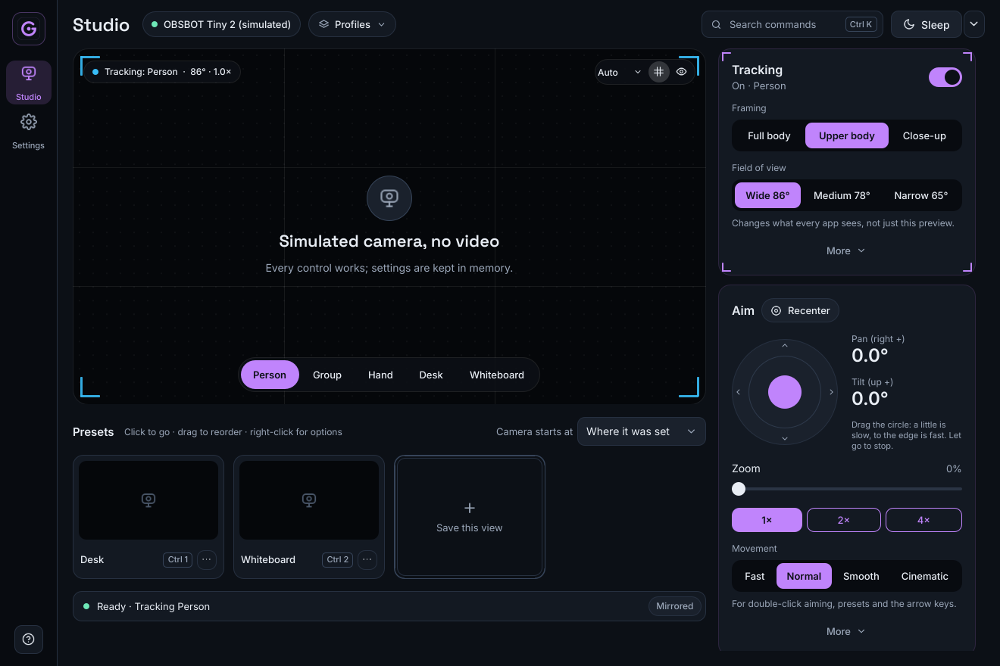
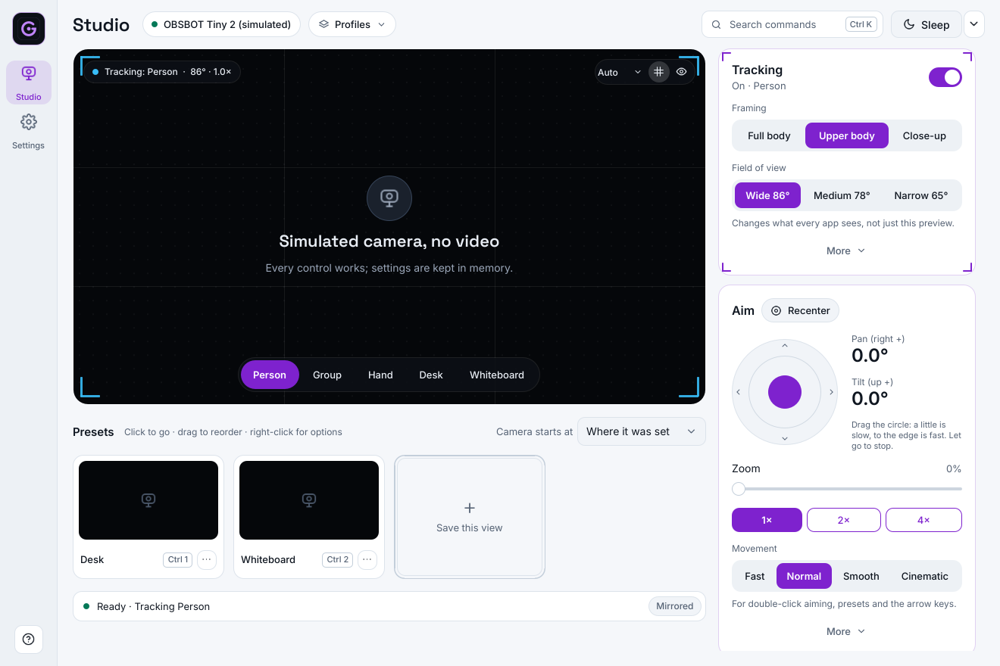

<p align="center"></p>

# Gimbot

A modern Linux app for controlling the OBSBOT Tiny 2 camera, made for KDE
Plasma on CachyOS and other Arch-based systems. **Unofficial; not affiliated
with OBSBOT or Remo Tech.**

<p align="center">
  
  
</p>

## Install

1. **Get the OBSBOT SDK.** Apply at <https://obsbot.com/sdk>; OBSBOT emails you
   a zip like `libdev_v2.1.0_8.zip`. Save it to your **Downloads** folder.
   (It can't be shared here, so everyone gets their own copy from OBSBOT.)
2. **Paste this into a terminal:**

```sh
curl -fsSL https://raw.githubusercontent.com/Matt-B-007/Gimbot/main/install.sh | sh
```

That's it. It downloads the newest signed release, checks its checksum and
signature, builds Gimbot with your SDK, tests the build and installs it. If
the SDK isn't in Downloads yet, it tells you and waits.

It asks for your password once: Gimbot is installed as a system package
(pacman), because the OBSBOT SDK has to be built into it on your computer and
the camera permission rule needs a system folder.

**Updates:** Gimbot shows **Update now** when there's a new version, and only
installs releases whose checksum and signature check out. Choose normal or
beta updates in **Settings › App**. If an update misbehaves, **Go back** there
(or `gimbot-update --rollback`) reinstalls the version you had before.

**Uninstall:** **Settings › App › Uninstall Gimbot**, or:

```sh
curl -fsSL https://raw.githubusercontent.com/Matt-B-007/Gimbot/main/install.sh | sh -s -- --uninstall
```

## What it does

- **Live preview** at the sharpest quality for your window (or pick one from the quality menu): double-click anywhere to point the camera there, press and drag to steer, scroll to zoom, framing grid. While tracking, a blue frame and dot match the camera's own light
- **Tracking switch** on the main screen, plus person (full body, upper body, close-up), group, hand, desk and whiteboard modes, field of view and style. Moving the camera by hand pauses tracking with a clear **Resume** button (or resume automatically)
- **Smooth movement**: Fast, Normal, Smooth or Cinematic glides for double-click aiming, presets (angle and zoom together) and eased arrow keys
- **Aim pad**: drag the circle to move (a little is slow, to the edge is fast; let go to stop), with the live angle beside it. Up is up and right is right everywhere, with a two-step direction check if your camera disagrees
- **Main screen** has what you change during a call: white balance chips, focus and exposure (auto/manual), gestures, voice commands, tracking area, a profile switcher and a status line that says what the camera is doing and how to fix problems
- **Presets** with thumbnails, Ctrl+1–3 (the camera holds three), rename/update/delete from a right-click menu, drag to reorder, and pick which one the camera starts at
- **Tracking area drawn on the picture**: drag its corners, or the ends of a bar showing the whole turning range for areas wider than the picture
- **Camera states** with a clear next step: no camera, another app using the video, asleep (with the sleep picture choice), preview off
- **Status light level** (Off, 1–3) shown on the main screen; the SDK can read it but not change it
- **Quick controls**: zoom buttons (1×, 2×, max), a sleep timer next to the Sleep button, anti-flicker and hue under Image, and every shortcut on one page (press `?`)
- **Every Tiny 2 setting in the SDK**, in seven groups: tracking area, startup position and mode, sleep timer, sleep picture, microphone during sleep, automatic mic volume, voice commands and language, field of view, exposure/shutter, focus, white balance presets and temperature, brightness/contrast/saturation/sharpness/hue, anti-flicker, HDR, mirror, zoom speed, gestures, reverse pan, guide light, factory reset
- **Profiles**: save whole setups ("Meetings", "Streaming"), switch in one click, import/export
- **Automatic camera detection**: plug in and it connects; unplug and it waits
- **Ctrl+K command search**, light/dark theme, optional Plasma accent color
- **Tray icon** and **system-wide shortcuts** (KDE), start at login, stays out of the way
- **Report a problem**: saves or copies a report with versions and a log (personal details hidden); nothing is sent automatically
- **Updates from inside the app** for normal or beta releases, and **Uninstall** from Settings
- **Made to be obvious**: hover hints with shortcuts, a first-run tour, Undo for resets and profile changes, plain-language errors with a Report button
- **`gimbotctl`** for scripts and keyboard shortcuts, routed through the running app over D-Bus

Camera firmware updates aren't possible from Linux (OBSBOT's SDK doesn't
offer them); use OBSBOT Center on Windows or macOS for those.

## Command line

| Command | What it does |
|---|---|
| `gimbot --version` | Shows the version |
| `gimbot --self-test` | Checks that everything works (`--quick` for the short check) |
| `gimbot --report` | Saves a problem report to Downloads, personal details hidden |
| `gimbot --update` | Installs the newest version for your update channel |
| `gimbot --rollback` | Goes back to the version you had before the last update |
| `gimbot --uninstall` | Removes Gimbot (asks about your settings) |
| `gimbot --hidden` | Starts in the tray |

The installer takes `--beta`, `--version TAG`, `--uninstall`, `--no-launch`
and `--from-source` (not verified), for example
`curl -fsSL …/install.sh | sh -s -- --beta`.

## Privacy

Gimbot never collects or sends:

- usage statistics, analytics or crash reports (nothing is sent automatically)
- your camera's picture or sound (the preview stays on your computer)
- your camera's serial number, unless you tick the box in a report
- an account or sign-in: there isn't one

It only connects to GitHub to check for and download updates (you can turn
the daily check off in **Settings › App**), to public DNS (1.1.1.1, 8.8.8.8)
if your own DNS can't find GitHub, and to the camera (the OBSBOT SDK also
looks for cameras on your local network). Reports are saved on your computer
and go nowhere until you attach them to an issue yourself.

## Problems?

- **In the app:** **Help (?) › Report a problem** saves the details to a file
  (or copies them) with your home folder, names, addresses and secrets hidden.
  **Open on GitHub** makes a public issue with just the summary; attach the
  saved file to it. Nothing is sent without you seeing it.
- **"Can't reach GitHub":** check the internet connection, then press **Try
  again** in **Settings › App**. If the computer's DNS is broken, Gimbot and the
  installer ask a public DNS service instead.
- **Up moves the camera down:** **Settings › Movement and zoom › Check movement
  directions** fixes it in two clicks (and please report it).
- **Installing without the one line:** download the source zip, unzip it, and
  run `bash install.sh` inside the folder.

The installer moves the SDK zip out of Downloads into Gimbot's folder
(`~/.local/share/gimbot/sdk`); **Settings › Device** shows it. When OBSBOT sends
a newer SDK, save it to Downloads and Gimbot offers to rebuild with it.

## Where Gimbot keeps things

| What | Where |
|---|---|
| The app | `/usr/bin/gimbot`, `/usr/lib/gimbot/` (a pacman package, so system folders rather than `~/.local/bin`) |
| Settings | `~/.config/gimbot/gimbot.conf` (Qt's INI format), backups in `~/.config/gimbot/backups/` |
| Logs and crash traces | `~/.local/state/gimbot/` |
| Saved OBSBOT SDK and packages for Go back | `~/.local/share/gimbot/` |
| Build files while updating | `~/.cache/` (removed afterwards) |

These follow the house standard shared with CachyPlay, Sluice, StowLock and
Stream Preflight, except that the app itself lives in `/usr` because it's a
pacman package.

`gimbot --self-test` checks that everything works (`--quick` for the short
version).

Building by hand, `gimbotctl` and testing: [BUILDING.md](BUILDING.md).
Publishing versions: [RELEASING.md](RELEASING.md). Helping out:
[CONTRIBUTING.md](CONTRIBUTING.md). Getting help: [SUPPORT.md](SUPPORT.md).
Security problems: [SECURITY.md](SECURITY.md).
What changed in each version: [CHANGELOG.md](CHANGELOG.md).

## License

MIT for Gimbot's own code. The OBSBOT SDK belongs to Remo Tech and is not
covered. Inter and Space Grotesk typefaces: SIL Open Font License.
